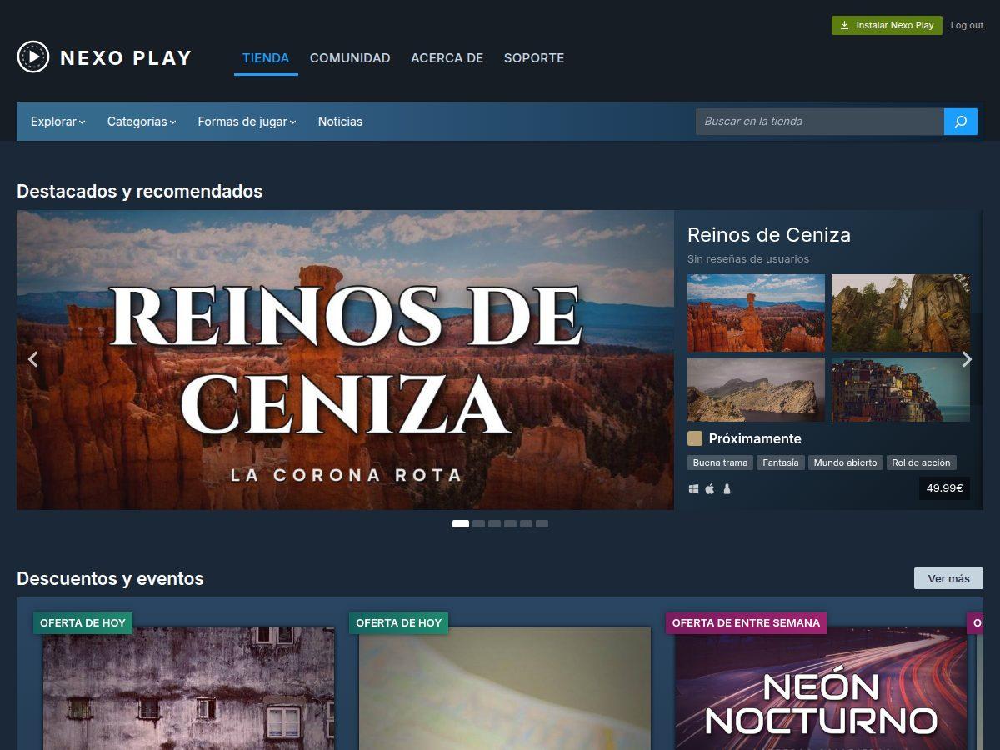
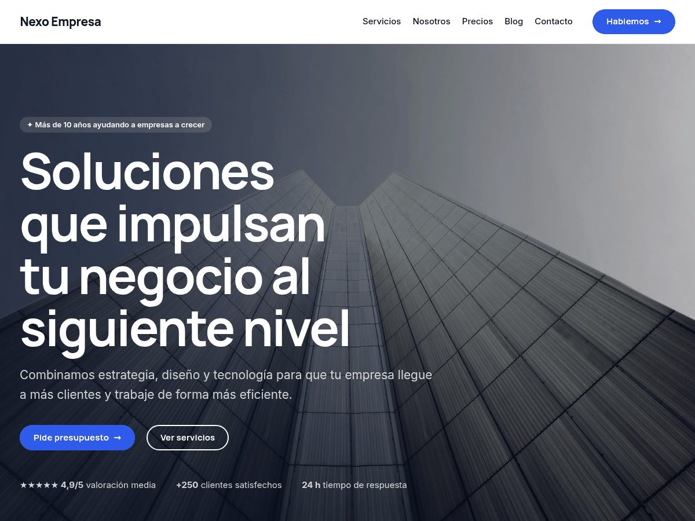

# Plantillas de WordPress para el proyecto de empresa

Este repositorio tiene **dos temas de WordPress** listos para instalar:

| Tema | Para qué | Descargar |
|---|---|---|
| **Nexo Empresa** | Web corporativa genérica para cualquier empresa: servicios, precios, equipo, contacto… | [`dist/nexo-empresa.zip`](dist/nexo-empresa.zip) |
| **Nexo Play** | Tienda de videojuegos con el estilo, los menús y la navegación de una gran plataforma digital | [`dist/nexo-play.zip`](dist/nexo-play.zip) |

Los dos se instalan igual: **Apariencia › Temas › Añadir nuevo tema › Subir tema**, eliges el zip,
**Instalar** y **Activar**. Después, en **Apariencia › … primeros pasos**, un botón crea todo el
contenido de ejemplo.

> Descarga el zip con el botón *Download raw file* de GitHub. No uses *Code › Download ZIP*:
> ese descarga el repositorio entero y WordPress lo rechaza.

---

## Nexo Play: tienda de videojuegos



Imita la estructura de páginas, menús y navegación de una tienda digital de videojuegos
(como la de Steam) con una marca propia: **no usa nombres, logotipos ni imágenes de ninguna
plataforma real**. Las portadas de los 16 juegos de ejemplo son ficticias y están hechas con
fotos libres de Unsplash.

**Qué incluye**

- **Cabecera doble**: logotipo con menú *Tienda · Comunidad · Acerca de · Soporte*, botón verde
  «Instalar», acceso de usuario, y debajo la barra de la tienda con desplegables *Explorar*,
  *Categorías* (menú grande con todos los géneros), *Formas de jugar* y *Noticias*, más el buscador.
- **Portada de la tienda**: banner, carrusel «Destacados y recomendados» (las capturas se ven en
  grande al pasar el ratón), «Descuentos y eventos», banner de descubrimientos, dos géneros
  destacados, pestañas *Novedades / Lo más vendido / Próximos / Ofertas / Gratuitos* con vista
  previa, «Explorar por categoría» y «A menos de 10 €».
- **Ficha de cada juego**: migas de pan, galería de capturas, portada, reseñas, fecha,
  desarrollador, etiquetas, caja de compra con descuento y botón verde «Añadir al carro»,
  formas de jugar, requisitos del sistema y «Más como este».
- **Buscador**: resultados en filas con filtros de precio, ofertas, géneros y formas de jugar,
  y orden por relevancia, fecha, nombre o precio.
- **Páginas**: Comunidad, Acerca de (con cifras de jugadores), Soporte (temas de ayuda y
  preguntas frecuentes) y Noticias.

**Cómo se edita**

- **Juegos**: menú **Juegos › Añadir juego**. Escribe título y descripción, pon la *Imagen
  destacada* (portada horizontal, 1232 × 706 px) y rellena el panel lateral **Datos del juego**:
  precio, descuento, etiqueta de oferta, fecha (si es futura sale como «Próximamente»),
  desarrollador, valoración, plataformas, capturas, portada vertical, requisitos y el enlace
  del botón de compra. Los géneros, etiquetas y formas de jugar están en el mismo panel.
  La tienda entera se actualiza sola.
- **Portada y páginas**: **Páginas › Tienda**. Cada sección es un bloque de la categoría
  **«Nexo Play · Tienda»** (botón **+**). Selecciónalo y en la barra lateral cambias el título,
  cuántos juegos salen, de qué género, el precio máximo…
- **Menús, cabecera y pie**: **Apariencia › Editor › Patrones › Partes de la plantilla**.
- **Colores**: **Apariencia › Editor › Estilos**.
- **Botón «Añadir al carro»**: enlaza a lo que pongas en el campo *Enlace* de cada juego
  (tu tienda, WooCommerce, una plataforma externa…). Si lo dejas vacío, lleva a Soporte.

**Bloques propios** (10): Destacados y recomendados · Descuentos y eventos · Estantería de juegos
(carrusel o panel, por popularidad, novedades, ofertas, próximos, gratuitos, género o precio) ·
Pestañas de la tienda · Explorar por categoría · Buscador de juegos · Ficha: cabecera y galería ·
Ficha: comprar · Ficha: detalles · Ficha: requisitos.

---

## Nexo Empresa: web corporativa para cualquier empresa

Tema de WordPress **genérico, modular y profesional** para montar la web de una empresa sin programar.
Está hecho como **tema de bloques** y todo se edita de forma visual (arrastrar, soltar, cambiar
textos, colores e imágenes) con el editor que ya trae WordPress, que funciona como un maquetador
tipo Elementor. **También es compatible con Elementor** si prefieres usarlo.



### Qué incluye

| | |
|---|---|
| **28 secciones listas** | Portadas (3), cabecera de página, servicios, ventajas, servicio destacado, proceso, sobre nosotros, misión/visión/valores, cifras, equipo, proyectos, logotipos de clientes, testimonios (2), precios, preguntas frecuentes, llamadas a la acción (2), contacto con formulario, mapa, últimas entradas, 3 cabeceras y 2 pies. |
| **5 páginas completas** | Inicio, Servicios, Nosotros, Precios y Contacto: se insertan con un clic al crear una página. |
| **7 combinaciones de color** | La original (azul) + Océano, Terracota, Bosque, Violeta, Elegante (negro y dorado) y Modo oscuro. Se cambian en un clic y todo el diseño se adapta. |
| **Bloque «Icono»** | 46 iconos con buscador, tamaño, forma (cuadrado, círculo o sin fondo) y colores. |
| **Animación y visibilidad** | En cualquier bloque: animaciones al hacer scroll (aparecer, subir, desde un lado, zoom) con retraso, y ocultar en móvil, tableta u ordenador. |
| **22 estilos de bloque** | Tarjetas, tarjeta elevada, cristal, antetítulo, etiqueta, botón con flecha, botón suave, lista con checks, acordeón, imagen con marco… |
| **Formulario de contacto** | Propio, sin plugins: `[nexo_contacto]`, con protección antispam y casilla de privacidad. |
| **Contenido de ejemplo** | Un botón crea todas las páginas, 3 entradas de blog con imagen y el menú. |
| **Recursos gratuitos incluidos** | Fotos de Unsplash, tipografías Inter y Manrope (alojadas en el propio tema, sin Google Fonts) e iconos Lucide. Todo con licencia libre, también para uso comercial. |

### Instalación (5 minutos)

1. Descarga **[`dist/nexo-empresa.zip`](dist/nexo-empresa.zip)** (botón *Download raw file* en GitHub).
2. En tu WordPress ve a **Apariencia › Temas › Añadir nuevo tema › Subir tema**, elige el zip y pulsa **Instalar ahora** y luego **Activar**.
3. Ve a **Apariencia › Nexo: primeros pasos** y pulsa **Crear contenido de ejemplo**.
   Se crean las páginas Inicio, Servicios, Nosotros, Precios, Blog y Contacto ya maquetadas,
   tres entradas y el menú, y la página Inicio queda como portada.
4. Pon tu nombre en **Ajustes › Generales** (nombre del sitio y lema).

> ¿No tienes WordPress? Para probar gratis y sin instalar nada puedes usar
> [WordPress Playground](https://playground.wordpress.net/) (sube el zip desde *Apariencia › Temas*)
> o [LocalWP](https://localwp.com/) en tu ordenador.

### Cómo se edita

#### Cambiar colores y tipografías (toda la web a la vez)
**Apariencia › Editor › Estilos** (icono de medio círculo). Elige una de las combinaciones o
toca cada color y tipografía. Como todas las secciones usan esa paleta, cambia la web entera.

#### Montar o cambiar una página
1. Abre la página (**Páginas › Inicio**, por ejemplo).
2. Pulsa el **+ azul** (arriba a la izquierda) › pestaña **Patrones** › categorías **«Nexo ·»**.
3. Arrastra la sección que quieras. Haz clic en cualquier texto o imagen para cambiarlo.
4. Reordena las secciones con las flechas ↑↓ o desde la **Vista de lista** (icono ☰):
   cada sección tiene su nombre (Portada, Servicios, Precios…).
5. Selecciona un bloque y, en la barra de la derecha, abre **Animación y visibilidad** para
   añadir efectos o esconderlo en móvil.

Al crear una **página nueva** aparece un selector con las 5 páginas completas para empezar desde una.

#### Cabecera, pie y logotipo
**Apariencia › Editor › Patrones › Partes de la plantilla**. En la cabecera sube tu logo con el
bloque *Logo del sitio*. Puedes cambiar la cabecera por otra versión (centrada o con barra de
contacto) desde el panel de la derecha › **Diseño**.

#### Menú
En la cabecera, selecciona el bloque **Navegación** y añade, quita o reordena enlaces.

#### Plantillas de página
En la barra derecha de cada página, apartado **Plantilla**:

| Plantilla | Para qué |
|---|---|
| Páginas (por defecto) | Página con banda de título arriba. Para textos: aviso legal, privacidad… |
| **Página de secciones (sin título)** | Páginas montadas con secciones. La usan las páginas de ejemplo. |
| **Ancho completo (Elementor y maquetadores)** | Conserva la cabecera y el pie del tema y deja todo el ancho al maquetador. |
| **Lienzo en blanco** | Sin cabecera ni pie: landing pages. |

### Usarlo con Elementor

1. Instala **Elementor** (gratis) desde **Plugins › Añadir nuevo**.
2. En la página que quieras, elige la plantilla **Ancho completo (Elementor y maquetadores)**
   y pulsa **Editar con Elementor**. La cabecera, el pie y los colores del tema se mantienen.
3. Para diseñar la página entera desde cero usa **Lienzo en blanco** (o *Elementor Canvas*).
4. Con **Elementor Pro** puedes sustituir la cabecera y el pie desde su *Theme Builder*: el
   tema registra todas sus ubicaciones.

Puedes mezclar: unas páginas con el editor de bloques y otras con Elementor.

### Formulario de contacto

La sección *Contacto* usa el shortcode `[nexo_contacto]`. Los mensajes llegan al correo de
**Ajustes › Generales › Dirección de correo electrónico de administración**. Para enviarlos a otro:

```
[nexo_contacto correo="info@tuempresa.com" boton="Pedir presupuesto"]
```

Muchos hostings no envían bien correos desde WordPress: si no te llegan, instala el plugin
gratuito **WP Mail SMTP**. Si prefieres otro formulario (Contact Form 7, WPForms, el de
Elementor Pro…), sustituye el bloque *Shortcode* por el suyo.

### Personalizar para tu empresa (lista rápida)

- [ ] Nombre y lema en *Ajustes › Generales*.
- [ ] Logotipo e icono del sitio en la cabecera.
- [ ] Combinación de colores en *Estilos*.
- [ ] Textos de cada sección (servicios, precios, preguntas frecuentes…).
- [ ] Fotos: las incluidas son de ejemplo; usa fotos reales siempre que puedas.
- [ ] Datos de contacto en la sección *Contacto*, el pie y el mapa (bloque HTML: cambia `q=` por tu dirección).
- [ ] Enlaces de redes sociales (bloque *Iconos sociales* del pie).
- [ ] Páginas legales: aviso legal, privacidad y cookies (enlazadas en el pie).
- [ ] Logotipos de clientes y testimonios: son ficticios, cámbialos o borra la sección.

### Estructura del tema

```
nexo-empresa/
├── style.css               Cabecera del tema
├── theme.json              Sistema de diseño: colores, tipografías, espaciados, sombras
├── functions.php           Carga de estilos, categorías de secciones, utilidades
├── header.php / footer.php Cabecera y pie para plantillas PHP de plugins (Elementor)
├── templates/              Plantillas (inicio del blog, entrada, página, 404, lienzo…)
├── parts/                  Cabecera y pie (editables en el Editor)
├── patterns/               Las 28 secciones, 5 páginas y 6 plantillas internas
├── styles/                 Las 6 combinaciones de color
├── blocks/icono/           Bloque «Icono»
├── inc/                    Estilos de bloque, formulario, importador, compatibilidad
└── assets/                 CSS, JS, fuentes, imágenes y licencias
```

## Volver a generar los zip

Si cambias archivos de un tema, desde la raíz del repositorio:

```bash
./crear-zip.sh
```

## Requisitos

Los dos temas: WordPress 6.6 o superior (probados en 7.1) y PHP 7.4 o superior.

## Licencias y créditos

Los temas se distribuyen bajo **GPL v2 o posterior**. Los autores de cada foto y las licencias
completas están en el `readme.txt` de cada tema. Recursos de terceros:

- Fotografías de [Unsplash](https://unsplash.com/license) (uso libre, también comercial). Autores en `nexo-empresa/readme.txt`.
- Tipografías [Inter](https://rsms.me/inter/) y [Manrope](https://github.com/sharanda/manrope): SIL Open Font License 1.1.
- Iconos [Lucide](https://lucide.dev): licencia ISC.
- Logotipos de clientes y avatares: creados para este tema (marcas ficticias).
- Nexo Play: portadas y capturas de los 16 juegos ficticios creadas a partir de fotos de Unsplash
  y tipografías de Google Fonts (SIL OFL). Nexo Play no está afiliado a ninguna plataforma de
  videojuegos ni usa sus marcas.
